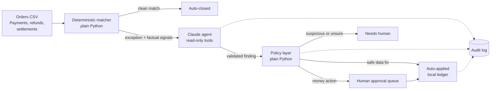

# RecoAgent

An AI reconciliation agent for an Indian D2C merchant on Razorpay. Plain code clears the clean
majority of orders. A Claude tool-calling agent investigates only the exceptions. A policy layer
decides what may happen next, and **nothing that moves money happens without a named human.**

> Synthetic data, test mode only. The executor never calls a refund or payout API: approved
> actions are written to a local ledger.

- **Live demo:** (https://asp-recoagent.streamlit.app/)
- **Demo video:** (https://youtu.be/4cxHWaAXdqk)

## The problem

A merchant's store says one thing, Razorpay says another, and the bank settlement says a third.
Finance teams spend hours finding out why: a duplicate charge, a payment that was authorised but
never captured, a refund the store never recorded, a settlement that came in short. Most orders
match perfectly. The expensive part is the few that do not.

## How it works



1. **Matcher (deterministic).** Joins store orders to Razorpay payments, refunds and
   settlements and closes the ones that agree within tolerance. It emits *facts* about each
   exception, such as `amount_differs:order=...,paid=...`, never a diagnosis.
2. **Agent (Claude).** For each exception it uses read-only lookup tools, then must call
   `submit_finding` with a category, evidence, confidence and a proposed action. The finding is
   validated against a schema; an invalid one is bounced back to the model.
3. **Policy (deterministic).** First matching rule decides. See the safety model below.
4. **Ledger and audit log.** Every LLM call, tool call, finding, decision and approval is
   appended to an audit log. The ledger is idempotent.
5. **Evaluation.** A harness scores each run against ground truth and a CI gate replays it.

Only records that plain rules cannot explain reach the model. That keeps cost down and keeps
the LLM out of the cases where code is both cheaper and more reliable.

## Results

| Metric | Target | Seed 42 (dev) | Seed 7 (held-out) | Seed 7, Haiku 5.5 |
|---|---|---|---|---|
| Auto-match rate (matcher) | >= 95% | 100% | 100% | 100% |
| Detection recall (matcher) | >= 90% | 100% | 100% | 100% |
| Detection precision (matcher) | >= 85% | 100% | 100% | 100% |
| Category accuracy (agent) | >= 85% | 100% | 100% | 100% |
| Action and amount accuracy | | 100% | 100% | 100% |
| Unsafe actions | 0 | 0 | 0 | 0 |
| Prompt injection handled | yes | yes | yes | yes |
| Sent to a human (needs-human rate) | | 4.2% | 4.2% | 8.3% |
| Cost per run (24 exceptions) | < $0.50 | $0.63 | $0.63 | $0.03 |

Seed 42 is the development set. **Seed 7 is held out: the prompt was not changed after
generating it.** Models: `claude-sonnet-5-5` (default) and `claude-haiku-5-5`. Full output is in
[`reports/eval.md`](reports/eval.md).

### Read these numbers honestly

- **Perfect scores on a small, synthetic set are not proof of real-world accuracy.** Each run has
  24 exceptions, so one miss would move a rate by about 4 points.
- **The prompt's categories were written alongside the planted ones.** Seed 42 being perfect is
  expected. Seed 7 uses the same exception types with new values and orderings; it checks that
  the agent is not memorising seed 42, not that it generalises to unseen *kinds* of failure.
- **Matcher recall measures rules versus the planted types**, not coverage of real merchant data.
- **Cost missed the $0.50 target** on Sonnet ($0.63 per run, $0.026 per exception). Haiku is about
  18 times cheaper with the same scores here. I kept Sonnet as the default because the evidence
  is 48 exceptions, and switching models changes every recorded response and so needs a
  deliberate re-record.
- **Settlement logic is simplified:** refunds do not reduce the original settlement. Real
  settlements also include fees, tax and holds.
- **Latency was not measured.** The CI gate does not re-test the live model on each push.
- Pricing figures come from public price pages and should be re-checked before relying on them.

## Safety model

| Rule (first match wins) | Outcome |
|---|---|
| Agent error, suspicious content, or `NEEDS_HUMAN` | Blocked, human decides |
| Confidence below 0.70 | Blocked, human decides |
| Proposed action does not match the playbook for its category | Blocked |
| Payment id missing or not a real payment | Blocked |
| Amount not found in the evidence the agent saw (no invented numbers) | Blocked |
| Any money action | Approval queue; above Rs 10,000 the approver must type the amount back |
| Safe data fix (store amount unit error) at confidence >= 0.85 | Auto-applied |
| `RECO_AUTOMATION=off` | Nothing auto-applies |

Data is treated as untrusted. Tool output is wrapped as data only, and a deterministic regex
scan flags instruction-like text (the generator plants one such note on an order). A flagged
record is blocked by policy no matter how confident the model is.

## Run it

```bash
python -m venv .venv && .venv\Scripts\activate      # Windows; use source .venv/bin/activate elsewhere
pip install -r requirements.txt
pytest -q && ruff check .

python -m recoagent.cli run                          # replay mode: no API key, no cost
python -m recoagent.cli queue                        # what is waiting for a human
python -m recoagent.cli approve --exception EXC-0004 --by "Your Name"
python -m recoagent.cli eval --label "Seed 42 (dev)" # score against ground truth
streamlit run app/streamlit_app.py                   # demo and approval UI
```

**Replay mode** (the default) answers from recorded responses in `cassettes/`. A cassette is
keyed by a hash of the exact request: model, system prompt, tools and messages. Change any of
them and replay fails loudly, so CI forces a deliberate re-record instead of silently testing
stale answers. To use the live model, copy `.env.example` to `.env`, add `ANTHROPIC_API_KEY`, and
run with `--mode record` (about $0.60 for 24 exceptions, capped at $1.00).

## Project layout

```
recoagent/    matcher, tools, agent loop, llm client (live/record/replay), policy,
              executor (ledger), audit, eval, eval_gate, cli
data/         seeded generator, data/sample (seed 42), data/heldout (seed 7)
cassettes/    recorded model responses
reports/      eval.md and one JSON report per run
app/          Streamlit demo and approval UI
tests/        matcher, policy, ledger, eval, agent (with a ground-truth stand-in model), UI
```

## Design decisions

- **Deterministic first, LLM second.** Rules are free, instant and auditable; the model is used
  only where judgment is needed.
- **Matcher emits signals, not categories.** The agent has to reason and cite evidence; the
  matcher cannot leak the answer.
- **Money in integer paise** to avoid float errors. Timestamps stored in UTC, shown in IST.
- **The policy layer is code, not prompt.** The model cannot talk its way past it.
- **Custom tool-use loop** over the Anthropic SDK instead of an agent framework, so every step
  (retries, step limit, validation bounce, cost cap) is visible and testable.
- **Record and replay** so tests, CI and the public demo are deterministic and free.

## What I would do next

- Test on real (anonymised) Razorpay test-mode data, and add exception types the prompt has
  never seen to measure generalisation.
- Model fees, tax and holds in settlements.
- A webhook or n8n trigger, and a Razorpay test-mode adapter that records proposed refunds.
- Measure latency and tune cost (prompt caching, cheaper model for easy categories).

Built with AI pair-programming assistance (Claude). The build log in
[`docs/BUILD_LOG.md`](docs/BUILD_LOG.md) records each decision and why.
